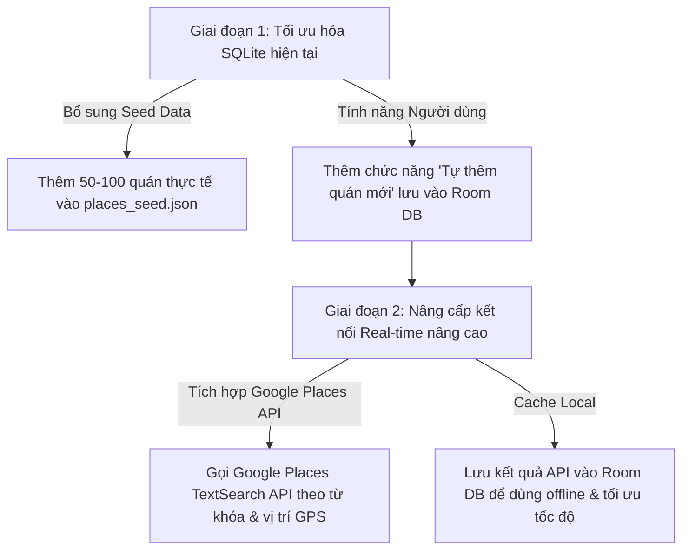

# Chiến lược Quản lý & Mở rộng Dữ liệu Quán ăn (Restaurant Data Strategy)

Phân tích bài toán dữ liệu quán ăn tĩnh trên SQLite (Room DB) và các hướng giải pháp nâng cấp để dữ liệu luôn phong phú, cập nhật và không bị lỗi thời (out-of-date).

---

## 1. Đánh giá Hiện trạng (Current State)

Ứng dụng hiện tại đang sử dụng mô hình **Static Seed Data** (`places_seed.json` nạp vào Room SQLite qua `SeedLoader` khi khởi động).

> [!NOTE]
> **Ưu điểm:**
> - Hoạt động ngoại tuyến (Offline-First) cực tốt, phản hồi tức thì.
> - Không phụ thuộc mạng Internet, không tốn phí hay cấu hình API Key phức tạp.
> - Phù hợp hoàn hảo cho đồ án (BTL) và các bài thuyết trình trên lớp.

> [!WARNING]
> **Hạn chế:**
> - Dữ liệu cố định (Hardcoded), dễ bị lỗi thời (out-of-date) khi quán đóng cửa, thay đổi giá, đổi địa chỉ hoặc có quán mới mở.
> - Phạm vi quán ăn bị giới hạn trong danh sách ban đầu.

---

## 2. Các Giải pháp Mở rộng & Tích hợp Dữ liệu

### Giải pháp 1: Mở rộng Seed Data thủ công + Tính năng "Tự thêm quán" (Crowdsourcing Local)
- **Cách thực hiện:**
  - Cập nhật thêm nhiều quán ăn thực tế vào file `places_seed.json`.
  - Bổ sung màn hình/dialog **Thêm quán ăn mới** cho phép người dùng tự nhập tên quán, địa chỉ, giá, món ăn và lưu trực tiếp vào Room SQLite cục bộ.
- **Ưu điểm:** Nhanh gọn, đơn giản, chi phí 0đ, chủ động hoàn toàn dữ liệu demo.
- **Nhược điểm:** Vẫn mang tính cục bộ, phụ thuộc vào việc người dùng hoặc dev tự nhập liệu.

### Giải pháp 2: Tích hợp Google Places API (Real-time Google Maps Integration)
- **Cách thực hiện:**
  - Sử dụng **Google Places API (Text Search / Nearby Search)** để truy vấn trực tiếp dữ liệu quán ăn từ Google Maps theo tọa độ GPS `(lat, lng)` và từ khóa món ăn.
  - Xây dựng cơ chế **Offline-First Caching**: Lưu các kết quả tìm kiếm từ Google Places vào Room Database để vừa có dữ liệu mới từ Google Maps vừa dùng được khi offline.
- **Ưu điểm:** Dữ liệu chuẩn xác 100% từ Google Maps (địa chỉ, hình ảnh, đánh giá, giờ mở cửa, khoảng cách thực tế), không bao giờ lỗi thời.
- **Nhược điểm:** Cần cấu hình Google Cloud API Key, bật Billing (Google có cung cấp hạn mức miễn phí hàng tháng - Free Tier), yêu cầu kết nối Internet khi tìm kiếm online.

### Giải pháp 3: Mô hình Cloud Database (Firebase Firestore / Supabase) + Đóng góp cộng đồng
- **Cách thực hiện:**
  - Chuyển database quán ăn từ SQLite cục bộ lên Cloud (Firebase Firestore).
  - Mọi người dùng đều có thể đóng góp quán ăn mới, cập nhật giá, và đồng bộ thời gian thực cho toàn hệ thống.
- **Ưu điểm:** Hiện đại, dữ liệu cộng đồng phong phú, tự động cập nhật.

---

## 3. Lộ trình Triển khai Đề xuất (Action Plan)

Dưới đây là kế hoạch chi tiết chia thành các giai đoạn để bạn dễ dàng áp dụng cho đồ án hoặc phát triển tiếp:

### Chi tiết công việc từng bước:
1. **Bước 1 (Ngắn hạn - Cải thiện ngay lập tức cho BTL):**
   - Làm phong phú file `places_seed.json` bằng cách bổ sung thêm các quán ăn nổi tiếng thực tế tại khu vực bạn muốn demo.
   - Thêm nút **"+ Thêm quán của bạn"** trên giao diện Bộ sưu tập hoặc Trang chủ để người dùng tự thêm quán mới vào cơ sở dữ liệu cục bộ.
2. **Bước 2 (Dài hạn - Chuyên nghiệp hóa):**
   - Đăng ký Google Cloud Console, tạo API Key cho **Places API**.
   - Viết Service/Repository gọi HTTP (dùng Retrofit hoặc OkHttp) để fetch dữ liệu từ Google Places kết hợp với vị trí GPS hiện tại của người dùng.
   - Lưu cache vào Room Database để ứng dụng vừa thông minh, vừa chạy mượt mà không lo giật lag hay mất mạng.
